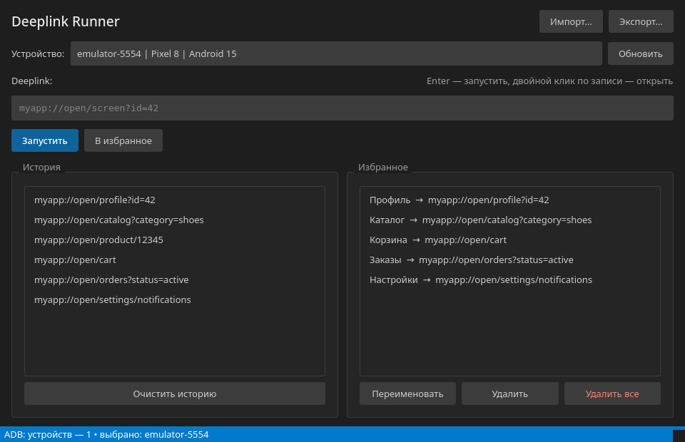

# Deeplink Runner

Небольшая утилита для запуска диплинков на Android-устройствах через ADB,
с историей, избранным и импортом/экспортом в JSON.



## Стек

- Python 3.9+
- [PySide6](https://doc.qt.io/qtforpython-6/) (Qt 6)
- Тёмная тема в цветах **VS Code Dark+**

## Установка

```bash
python -m venv .venv
source .venv/bin/activate        # Windows: .venv\Scripts\activate
pip install -r requirements.txt
```

Также нужен `adb` из Android platform-tools в `PATH`.

## Запуск

```bash
python deeplink_runner_qt.py
```

## Возможности

- выбор подключённого устройства (серийник, модель, версия Android);
- запуск диплинка на выбранном устройстве;
- история запусков и избранное с названиями;
- переименование и удаление записей;
- импорт и экспорт данных в JSON;
- тёмная тема VS Code, статус-бар с состоянием ADB.

Данные хранятся в `deeplinks.json` в системной папке приложения:

- Linux: `~/.local/share/ADB Deeplink Launcher/`
- macOS: `~/Library/Application Support/ADB Deeplink Launcher/`
- Windows: `%APPDATA%\ADB Deeplink Launcher\`

## Сборка

```bash
pyinstaller deeplink_runner_qt.spec
```
